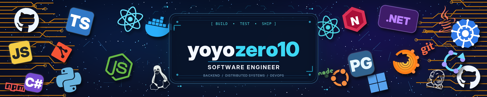

  

  

  

    
    
  

---

### About Me

  <b>Full Name:</b> Tran Dai Thang 
  <b>Nickname:</b> yoyozero9 
  <b>Birth Year:</b> 2005 
  <b>Coding Experience:</b> Copy - Paste Expert 😄 
  <b>Interests:</b> Service development, building tech solutions 
  <b>Motto:</b> <i>"Nothing is possible"</i> 
  <b>Goal:</b> Building breakthrough technology solutions 
  <b>Direction:</b> Expanding global service ecosystem

 

---

### Tech Stack

  
  
  
  
  
  
  
  
  
  
  

---

### GitHub Stats

  
  
  

